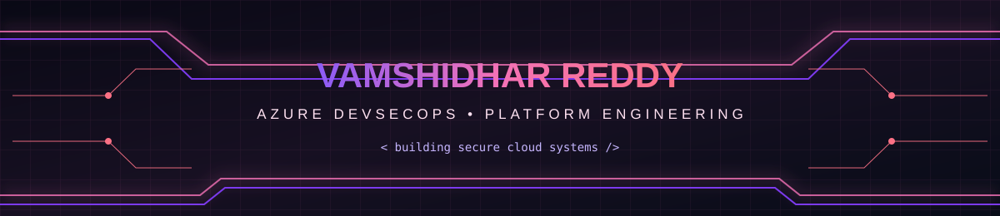
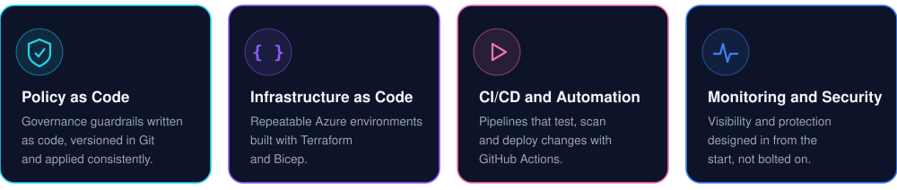
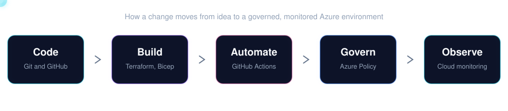

 

<h2 align="center">About me</h2>

 

<h2 align="center">What I work on</h2>

<h2 align="center">How I ship</h2>

<h2 align="center">Tech stack</h2>

<h2 align="center">Right now</h2>

**Studying** Azure Administration (AZ-104) &nbsp;|&nbsp; **Pursuing** database administration (DBA) &nbsp;|&nbsp; **Exploring** Azure Policy as Code &nbsp;|&nbsp; **Open to** cloud and open-source collaboration

<!-- Optional: uncomment after adding .github/workflows/snake.yml and running it once
<h2 align="center">Contribution graph</h2>

-->

 

