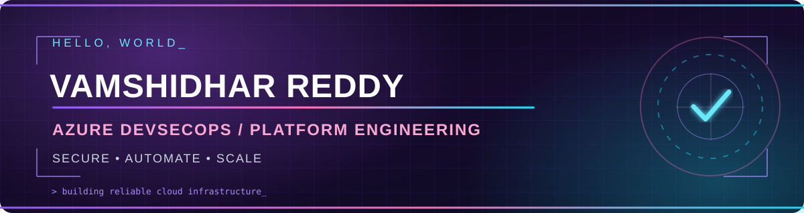

<div align="center">



<br />

<a href="https://git.io/typing-svg"></a>

<p>
  <a href="https://victorious-pond-04a340710.7.azurestaticapps.net"></a>
  <a href="https://www.linkedin.com/in/vamshidhar-reddy-g-387068290"></a>
  <a href="https://learn.microsoft.com/en-us/users/vamshidharreddygundlapally-3985/"></a>
</p>

</div>

---

### 👾 About me

```yaml
name: Vamshidhar Reddy Gundlapally
location: Atlanta, Georgia
focus: Azure DevSecOps & Platform Engineering
interests: [Cloud Governance, Infrastructure as Code, Security, Automation]
working_with: [Azure, Terraform, GitHub Actions, PowerShell, Python, Bicep]
currently_learning: [Azure Administration, Cloud Architecture]
mission: "Build secure, reliable systems that scale."
```

### ⚡ Tech universe

<div align="center">

</div>

<br />

**Cloud & platform:** Microsoft Azure · Azure Policy · Azure Monitor · Entra ID · Databricks  
**Infrastructure & automation:** Terraform · Bicep · PowerShell · Python · YAML · GitHub Actions  
**Governance & observability:** Azure Policy as Code · KQL · Event Hubs · Diagnostic Settings · CI/CD

### 🛠 Featured engineering work

> **Project showcase in progress.** These are topics I work on and plan to demonstrate in independent, sanitized sample repositories. Links will be added when the projects are published.

| Project lab | Focus |
| :--- | :--- |
| 🛡️ **Azure Policy as Code Lab** | Policy definitions, initiatives, assignments and compliance automation |
| ☁️ **Terraform Azure Infrastructure** | Reproducible Azure deployment patterns and modular IaC |
| 📡 **Azure Observability Lab** | Azure Monitor, diagnostic settings, Event Hubs and KQL |
| ⚙️ **DevSecOps Automation Toolkit** | GitHub Actions, Python and PowerShell automation |

### 🏅 Certifications

<p>

</p>

<!-- Add other certifications only after verifying they have been earned. -->

### 📊 GitHub stats

<div align="center">


</div>

<div align="center">

</div>

### 🐍 Contribution snake

<div align="center">

</div>

> The snake will appear after you enable Actions and run the included workflow once.

### 🤝 Let's connect

<div align="center">

**Open to collaborating on cloud automation, Azure infrastructure, and DevSecOps projects.**

<a href="https://www.linkedin.com/in/vamshidhar-reddy-g-387068290"></a>

<sub>Built with ☁️ Azure energy, automation, and a little neon.</sub>

</div>
